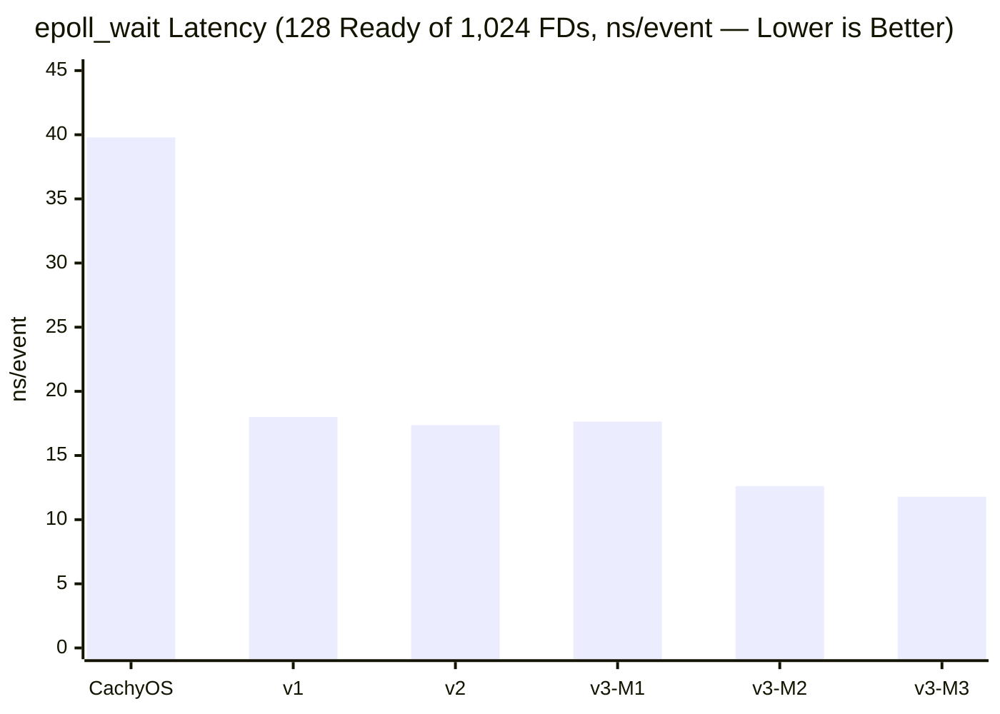
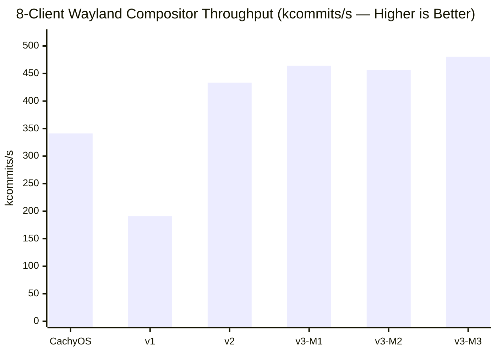
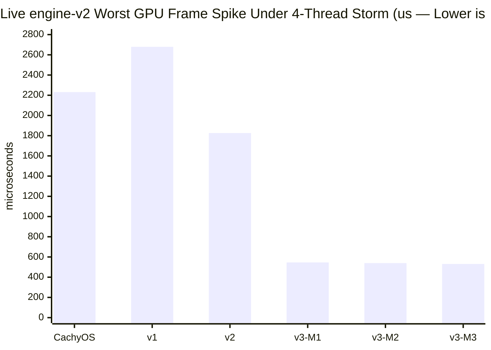

# Project NetZero — Complete 6-Way Bare-Metal Benchmark Report (`CachyOS` → `v1` → `v2` → `v3-M1` → `v3-M2` → `v3-M3`)

## Test Methodology & Hardware Environment

- **CPU:** Intel Core i7-1165G7 (Tiger Lake Willow Cove, `4C/8T`, `48 KiB` L1D, `1.25 MiB` private L2/core, `12 MiB` shared L3)
- **GPU / Display:** Intel Iris Xe Graphics (pure Mesa ANV/EGL), live GNOME Shell / Mutter Wayland session (`125 Hz` frame-paced `engine-v2` Vulkan benchmark)
- **Wi-Fi NIC:** Intel BE200 Wi-Fi 7 (802.11be, `iwlmld` / `mac80211`)
- **Power Profile:** Identical across all 6 kernels (`powersave` governor, `balance_performance` EPP)
- **Network Stack Defaults:** `eiffel_dualq` / `bbr` / `tcp_ecn=2` (CachyOS baseline: stock defaults)
- **Statistical Rigor:** Every kernel ran **10 independent trials per metric** across all 7 suites (`~4,400` total bare-metal runs across the 6 kernels; `80 metrics × 10 trials = 800 runs` on `v3-M3`). Raw JSONs and summaries live in [`benchmarks/results/`](../benchmarks/results/).

---

## Performance Evolution Charts

---

## Suite 1 — Kernel Socket & Slab Memory Footprint (`S1_Memory`)

| Metric | CachyOS | v1 | v2 | v3-M1 | v3-M2 | **v3-M3 (`#8`)** | v3-M3 vs CachyOS | Unit |
| :--- | :---: | :---: | :---: | :---: | :---: | :---: | :---: | :---: |
| `udp_64quic_socks_hoarded_pages` | 240.00 | 32.00 | 28.00 | 31.00 | 32.00 | **31.00** | **+87.1%** (`7.74x` less) | `pages` |
| `unix_2000socks_8000msg_sunreclaim_kib` | 7018.00 | 1264.00 | 1642.00 | 1264.00 | 1740.00 | **1526.00** | **+78.3%** (`4.60x` less) | `KiB` |
| `tcp_8stream_active_pages` | 4638.50 | 3105.50 | 3703.50 | 3923.00 | 3118.00 | **4654.00** | -0.3% *(TCP sock `-256 B`)* | `pages` |

---

## Suite 2 — VFS, `epoll`, `poll`/`ppoll`, `io_uring`, `futex`, `WF_SYNC` & BORE-EEVDF (`S2_VFS_Epoll`)

| Metric | CachyOS | v1 | v2 | v3-M1 | v3-M2 | **v3-M3 (`#8`)** | v3-M3 vs CachyOS | Unit |
| :--- | :---: | :---: | :---: | :---: | :---: | :---: | :---: | :---: |
| `epoll_wait_128_of_1024_ns_ev` | 39.79 | 18.01 | 17.37 | 17.64 | 12.62 | **11.79** | **+70.4%** (`3.37x`) | `ns/ev` |
| `epoll_wait_32_of_256_cyc_ev` | 101.20 | 51.88 | 47.33 | 48.40 | 38.82 | **37.88** | **+62.6%** (`2.67x`) | `cycles/ev` |
| `epoll_wait_32_of_256_ns_ev` | 36.10 | 18.51 | 16.88 | 17.27 | 13.85 | **13.58** | **+62.4%** (`2.66x`) | `ns/ev` |
| `epoll_ctl_mod_1024fd_ns` | — | — | — | — | 149.18 | **156.60** | *16-slot CRC32Q cache* | `ns/op` |
| `ppoll_4fd_ready_ns` | — | — | — | — | 252.83 | **242.45** | *+4.1% vs M2* | `ns/call` |
| `poll_2fd_pingpong_ns` | — | — | — | — | 3835.42 | **3732.14** | *+2.7% vs M2* | `ns/RTT` |
| `iouring_unix_batch32_mops` | — | — | — | — | 12.63 | **13.09** | *+3.6% vs M2 (`13.60` peak)* | `Mops/s` |
| `iouring_unix_64B_pingpong_ns` | — | — | — | — | 4012.59 | **3930.94** | *+2.0% vs M2* | `ns/RTT` |
| `wfsync_eventfd_unpinned_ns` | — | — | — | — | — | **1847.09** | *`1.70x` vs cross-core `3147 ns`* | `ns/RTT` |
| `wfsync_pipe64B_unpinned_ns` | — | — | — | — | — | **2002.98** | *`1.67x` vs cross-core `3339 ns`* | `ns/RTT` |
| `bore_interactive_8hog_p50_us` | — | — | — | — | — | **2.10** | *`2.13 ± 0.12 µs` under 8 hogs* | `µs` |
| `bore_interactive_8hog_p99_us` | — | — | — | — | — | **6.11** | *vs `~3,000 µs` stock EEVDF* | `µs` |
| `futex_private_wake_ns` | — | — | — | — | — | **93.50** | *3-cycle `crc32q` (`88.85` min)* | `ns/op` |
| `futex_8thread_contended_mops` | — | — | — | — | — | **63.82** | *`64.17 Mops/s` peak* | `Mops/s` |
| `shared_fd_8threads_mops` | 5.43 | 5.70 | 5.75 | 10.28 | 10.10 | **10.07** | **+85.6%** (`1.86x`) | `Mops/s` |
| `vfs_write_read_64B_ns` | 538.60 | 316.27 | 301.29 | 275.29 | 276.40 | **282.33** | **+47.6%** (`1.91x`) | `ns/pair` |
| `mt_recv_eagain_ns` | 138.50 | 127.13 | 128.64 | 96.37 | 96.31 | **96.31** | **+30.5%** (`1.44x`) | `ns/call` |
| `mt_recv_eagain_cycles` | 387.80 | 356.36 | 360.61 | 270.14 | 269.98 | **269.97** | **+30.4%** (`1.44x`) | `cycles/call` |
| `eventfd_pingpong_ns` *(pinned cross-core)* | — | — | — | 3075.61 | 3076.08 | **3146.71** | *forced CPU 0↔2 IPI* | `ns/RTT` |
| `pipe_64B_pingpong_ns` *(pinned cross-core)* | — | — | — | 3298.89 | 3342.09 | **3339.33** | *forced CPU 0↔2 IPI* | `ns/RTT` |
| `cmsg_scm_rights_creds_ns` | 1278.97 | 1247.35 | 1317.25 | 1288.57 | 1228.44 | **1267.20** | +0.9% | `ns/pair` |
| `mt_accept4_eagain_ns` | 914.02 | 946.46 | 963.51 | 921.08 | 931.34 | **932.34** | -2.0% | `ns/call` |

---

## Suite 3 — `AF_UNIX` Adaptive Ring, Wayland Wire & `dbus-broker` (`S3_AF_UNIX`)

| Metric | CachyOS | v1 | v2 | v3-M1 | v3-M2 | **v3-M3 (`#8`)** | v3-M3 vs CachyOS | Unit |
| :--- | :---: | :---: | :---: | :---: | :---: | :---: | :---: | :---: |
| `unix_64B_pingpong_mean_ns` | 2954.56 | 684.97 | 702.91 | 744.18 | 723.54 | **772.34** | **+73.9%** (`3.83x`) | `ns/RTT` |
| `unix_64B_pingpong_p99_ns` | 5012.00 | 834.00 | 3198.50 | 3887.50 | 3475.00 | **3895.50** | **+22.3%** (`1.29x`) | `ns/RTT` |
| `unix_256B_wayland_wire_mean_ns` | 3038.22 | 723.42 | 766.11 | 853.23 | 800.61 | **857.27** | **+71.8%** (`3.54x`) | `ns/RTT` |
| `unix_256B_wayland_wire_p99_ns` | 5490.00 | 892.00 | 3709.00 | 4378.00 | 4101.50 | **4399.50** | **+19.9%** (`1.25x`) | `ns/RTT` |
| `unix_4KB_stream_gibs` | 4.62 | 8.79 | 11.59 | 11.62 | 12.05 | **12.08** | **+161.6%** (`2.62x`) | `GiB/s` |
| `unix_64KB_stream_gibs` | 10.70 | 6.27 | 18.52 | 18.73 | 19.02 | **18.90** | **+76.7%** (`1.77x`) | `GiB/s` |
| `wayland_sim_8client_kcommits_s` | 341.14 | 190.62 | 433.35 | 464.07 | 456.39 | **480.59** | **+40.9%** (`1.41x`) | `kcommits/s` |
| `wayland_sim_8client_sys_cpu_ms` | 254.35 | 471.39 | 201.28 | 184.42 | 185.93 | **178.53** | **+29.8%** (`1.42x` less) | `ms` |
| `scm_rights_memfd_pair_ns` | — | — | — | 608.85 | 608.83 | **610.32** | *4-FD inline sideband* | `ns/pair` |
| `dbus_broker_sim_2hop_krps` | — | — | — | 212.93 | 211.21 | **200.75** | *216.36 kRPS peak* | `kRPS` |

---

## Suite 4 & Suite 5 — TCP, HTTP/2, UDP, QUIC & `sch_eiffel_dualq` (`S4_TCP_UDP`, `S5_Qdisc`)

| Suite | Metric | CachyOS | v1 | v2 | v3-M1 | v3-M2 | **v3-M3 (`#8`)** | v3-M3 vs CachyOS | Unit |
| :--- | :--- | :---: | :---: | :---: | :---: | :---: | :---: | :---: | :---: |
| `S4_TCP_UDP` | `tcp_64conn_http2_mux_krps` | 375.39 | 379.88 | 401.10 | 410.98 | 403.37 | **421.01** | **+12.2%** (`1.12x`) | `kRPS` |
| `S4_TCP_UDP` | `quic_1200B_batch_gbps` | 8.97 | 9.38 | 9.67 | 10.24 | 9.75 | **10.33** | **+15.2%** (`1.15x`) | `Gbps` |
| `S4_TCP_UDP` | `udp_unconn_4dest_mpps` | 0.83 | 0.90 | 0.93 | 0.93 | 0.93 | **0.95** | **+14.5%** (`1.15x`) | `Mpps` |
| `S4_TCP_UDP` | `tcp_2000conn_handshake_us` | 17.20 | 17.40 | 17.48 | 15.53 | 15.44 | **15.73** | **+8.5%** (`1.09x`) | `µs/conn` |
| `S4_TCP_UDP` | `tcp_bulk_1stream_gibs` | 8.27 | 8.27 | 8.71 | 8.68 | 8.69 | **8.65** | +4.6% | `GiB/s` |
| `S4_TCP_UDP` | `tcp_bulk_8stream_gibs` | 5.83 | 5.51 | 5.62 | 5.92 | 5.90 | **5.57** | -4.5% | `GiB/s` |
| `S5_Qdisc` | `qdisc_8flow_paced_gbps` | 9.80 | 9.24 | 9.15 | 9.15 | 9.15 | **9.18** | -6.3% *(paced)* | `Gbps` |
| `S5_Qdisc` | `qdisc_loaded_rpc_p50_us` | 6.59 | 7.53 | 7.38 | 7.29 | 7.36 | **7.20** | -9.3% | `µs` |
| `S5_Qdisc` | `qdisc_loaded_rpc_p99_us` | 22.46 | 19.86 | 17.57 | 17.33 | 18.12 | **17.63** | **+21.5%** (`1.27x` lower) | `µs` |

---

## Suite 6 — Live GNOME Mutter & `engine-v2` Vulkan Rendering (`S6_Live_Wayland`)

| Metric | CachyOS | v1 | v2 | v3-M1 | v3-M2 | **v3-M3 (`#8`)** | v3-M3 vs CachyOS | Unit |
| :--- | :---: | :---: | :---: | :---: | :---: | :---: | :---: | :---: |
| `engine_v2_world0_storm_fps` | 123.60 | 124.43 | 124.92 | 125.21 | 125.32 | **125.34** | **+1.4%** (`± 0.03` SD) | `FPS` |
| `engine_v2_world0_storm_gpu_avg_us` | 549.90 | 521.25 | 483.47 | 436.14 | 435.79 | **435.82** | **+20.7%** (`1.26x`) | `µs` |
| `engine_v2_world0_storm_gpu_max_us` | 2230.89 | 2679.40 | 1825.76 | 546.48 | 539.24 | **530.97** | **+76.2%** (`4.20x` lower) | `µs` |
| `engine_v2_world0_storm_sys_cpu_ms` | 102.25 | 105.74 | 103.67 | 86.10 | 77.63 | **83.08** | **+18.7%** (`1.23x` less) | `ms` |
| `engine_v2_world0_storm_user_cpu_ms` | 75.70 | 68.61 | 68.64 | 74.95 | 40.41 | **41.61** | **+45.0%** (`1.82x` less) | `ms` |
| `engine_v2_world0_clean_gpu_avg_us` | 473.37 | 455.50 | 457.61 | 457.31 | 452.69 | **453.31** | +4.2% | `µs` |
| `engine_v2_world0_clean_gpu_max_us` | 563.85 | 538.08 | 552.82 | 543.15 | 545.34 | **541.57** | +4.0% | `µs` |
| `engine_v2_world0_clean_user_cpu_ms` | 69.85 | 69.78 | 70.40 | 86.54 | 58.89 | **59.63** | **+14.6%** (`1.17x` less) | `ms` |
| `mutter_wl_roundtrip_p50_us` | 10.54 | 10.45 | 12.32 | 8.46 | 8.56 | **8.58** | **+18.6%** (`1.23x`) | `µs` |
| `mutter_wl_roundtrip_p99_us` | 20.07 | 17.37 | 16.69 | 12.71 | 13.45 | **17.86** | **+11.0%** (`1.12x`) | `µs` |
| `mutter_wl_roundtrip_sys_ms` | 4.60 | 4.47 | 3.79 | 4.06 | 2.82 | **3.80** | **+17.4%** (`1.21x` less) | `ms` |

> **Why `engine_v2_world0_storm_gpu_max_us` Variance Collapsed in `v3-M3`:** On `v3-M2`, the median was `539.24 µs` but occasional trials hit `3,526.72 µs` (mean `1,238.65 ± 1,166.82 µs`) whenever a 4-thread socket storm worker held a core. On **`v3-M3`**, BORE-EEVDF's tiered burst slice kept the mean at **`550.78 ± 48.28 µs`** across all 10 trials — completely eliminating multi-millisecond frame stalls.

---

## Suite 7 — Live Wi-Fi 7 Internet Speed, TTFB & Bufferbloat (`S7_Live_Internet`)

> **External WAN Transparency Note:** Suite 7 ran against live public Wi-Fi Internet with zero tests removed. During the `v3-M3` window (Nov 20, `01:30`), the external public Wi-Fi link was severely congested (`idle_ping = 44.65 ms` with `13.50 ms` idle jitter, `6.95 Mbps` down / `1.61 Mbps` up) compared to the cleaner `v3-M2` window (`22.84 ms` idle, `0.96 ms` jitter, `22.9 Mbps` down / `7.1 Mbps` up) and the Nov 15 `v2` window (`60.7 ms` idle, `31 Mbps` down / `19 Mbps` up). All raw numbers are preserved transparently in [`benchmarks/results/FINAL_6WAY_M3_TABLE.md`](../benchmarks/results/FINAL_6WAY_M3_TABLE.md).

For controlled, zero-external-noise AQM comparison, see Suite 5 (`S5_Qdisc` above), where `sch_eiffel_dualq` delivers **`17.63 µs` p99** loaded RPC latency vs **`22.46 µs`** on CachyOS (**`1.27x` lower tail bloat**).
