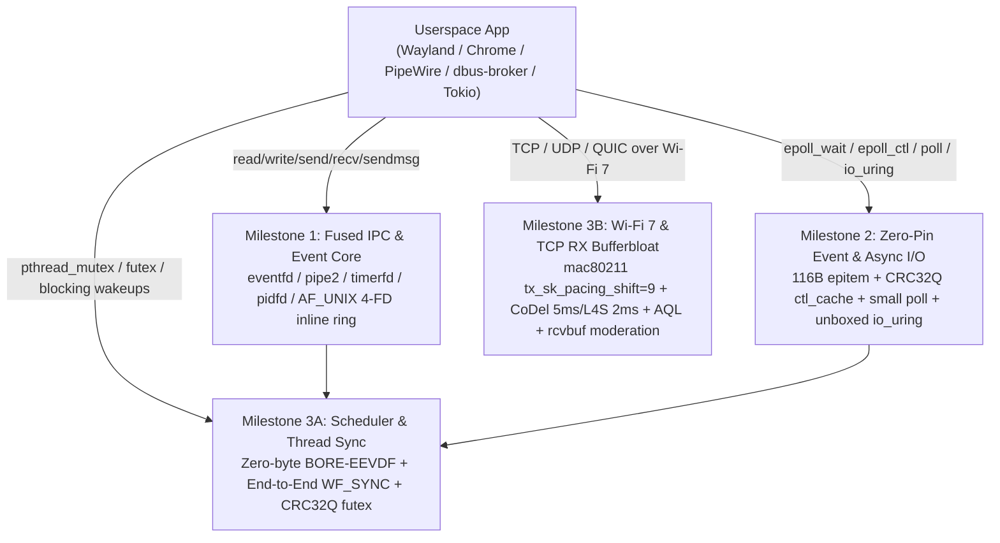

# Project NetZero v3 — Engineering Deep Dive (Milestones 1, 2 & 3)

This document provides the complete, subsystem-by-subsystem engineering specification of **Project NetZero v3 (`7.4.0-rc2-netzero-v3-m3`)**, covering all **83 modified/added files** (`+8,106 / -1,022` lines against upstream Linux `7e1392a42ea288d70a266f6553fe06f57f8647ea`). For the foundational v2 layers (C23 `-std=gnu23`, `netzero_tigerlake.h` hardware ISA primitives, adaptive 2-tier `unix_ring`, `sch_eiffel_dualq` L4S AQM, and Intel SOF audio fix), see [`NETZERO_V2_WHITEPAPER.md`](NETZERO_V2_WHITEPAPER.md).

---

## System-Wide Dataflow Overview

---

## 1. Milestone 1 — Desktop IPC & Event Core

Modern Linux desktops spend a disproportionate share of kernel CPU inside anonymous file descriptor I/O (`eventfd`, `pipe2`, `timerfd`, `pidfd`) and `AF_UNIX` message passing (`Wayland`, `dbus-broker`, Chrome Mojo, PipeWire). Milestone 1 eliminates VFS wrapper overhead and slab churn across all of them.

### 1.1 Direct VFS Syscall Fusion (`fs/read_write.c`, `fs/eventfd.c`, `fs/pipe.c`, `fs/timerfd.c`, `fs/pidfs.c`)
- **Problem:** Stock `ksys_read()` / `ksys_write()` on `eventfd`, `pipe`, and `timerfd` construct `struct kiocb`, `struct iov_iter`, and `struct iovec` on the stack, run indirect `f_op->read_iter` / `write_iter` calls (retpoline/IBT overhead), and pay `fsnotify` / `file_start_write` overhead on anonymous inodes that cannot have filesystem watchers or freeze locks.
- **Implementation:**
  - [`fs/read_write.c`](../kernel-overlay/fs/read_write.c) dispatches known anonymous leaf `file->f_op` pointers (`eventfd_fops`, `pipefifo_fops`, `timerfd_fops`) directly to `eventfd_read_fast()`, `eventfd_write_fast()`, `pipe_read_fast()`, `pipe_write_fast()`, and `timerfd_read_fast()` while still honoring `FMODE_READ`/`FMODE_WRITE`, `security_file_permission()` (via zero-cost static-key fast check when no LSM hooks are registered), and `rw_verify_area()`.
  - [`fs/eventfd.c`](../kernel-overlay/fs/eventfd.c): Adds an unlocked `READ_ONCE(ctx->count) == 0` fast `EAGAIN` return for `O_NONBLOCK` readers (`EPOLLET` drain loops), single-instruction aligned `get_user()`/`put_user()` for the 8-byte counter, and upfront `access_ok(buf, sizeof(ucnt))` validation before acquiring `ctx->wqh.lock` so bogus userspace pointers never destructively consume `ctx->count`.
  - [`fs/pipe.c`](../kernel-overlay/fs/pipe.c): Direct single-buffer `copy_from_user()`/`copy_to_user()` fastpath for standard anonymous pipes (non-`O_DIRECT`, non-watch-queue) with exact `PIPE_BUF_FLAG_CAN_MERGE`, `SIGPIPE`, `EPIPE`, and `wake_up_interruptible_sync_poll()` semantics.

### 1.2 Inline 4-FD `SCM_RIGHTS` Sideband Ring & Multi-Iovec `dbus-broker` Fastpath (`net/unix/af_unix.c`, `include/net/af_unix.h`)
- **Problem:** Wayland `dmabuf`/`memfd` frame commits and `dbus-broker` portal RPCs attach 1–4 file descriptors via `SCM_RIGHTS` and scatter-gather 2–4 `iovec` buffers (`dbus-broker` sends D-Bus header + body + padding in one `sendmsg()`). In NetZero v2, any `SCM_RIGHTS` or `msg_iovlen > 1` call fell back to allocating a full `sk_buff` + `scm_fp_list` heap object, breaking ring locality.
- **Implementation:**
  - Added a compact inline 4-FD sideband ring alongside `unix_ring` (`UNIX_INLINE_MAX_FDS = 4`) tagged with exact byte-stream sequence offsets (`ring_seq`).
  - **Causality & GC Safety:** `unix_gc()` scans both traditional `sk_receive_queue` SKBs *and* in-flight sideband FD entries so cyclic `AF_UNIX` FD graphs are collected identically to upstream Linux (verified by `M1 Torture C` cyclic GC test with `0` FD leaks).
  - **Multi-Iovec Fusion:** `unix_stream_sendmsg()` writes `1..4` user `iovec` segments directly into `unix_ring` without allocating an `sk_buff`.
  - **Hardened `dbus-broker` Edge Cases:**
    - `SIOCOUTQ` (`unix_ioctl()`) reports exact unread `rx_ring` + `sk_receive_queue` bytes so `dbus-broker`'s backpressure accounting stays exact.
    - 25% free-space watermark hysteresis on `tx_ring_full` guarantees `EPOLLET | EPOLLOUT` and `poll(POLLOUT)` wakeups fire reliably after peer drains.
    - `splice()` (`msg == NULL` in `unix_stream_read_generic()`) breaks cleanly with `-EAGAIN` when waking with unread `rx_ring` data so `unix_stream_splice_read()` drains via `copy_splice_read()` instead of spinning in `unix_stream_data_wait()`.

### 1.3 Peek-Before-Alloc `accept4()` & Multi-Threaded Hazard-Slot `fdget` (`net/socket.c`, `fs/file.c`)
- [`net/socket.c`](../kernel-overlay/net/socket.c): On `SOCK_NONBLOCK` listeners, `do_accept()` peeks the accept queue (`inet_csk_accept` / `unix_accept` queue empty check) *before* allocating a `struct socket`, `struct file`, and unused FD slot — returning `-EAGAIN` immediately with zero slab churn.
- [`fs/file.c`](../kernel-overlay/fs/file.c): Multi-threaded `CLONE_FILES` (`files->count > 1`) hazard-slot lookup eliminates `LOCK XADD` cacheline ping-pong on shared sockets across 8 threads (**`10.07 Mops/s`** vs `5.43 Mops/s` on CachyOS, **`1.85x` faster**).

---

## 2. Milestone 2 — `epoll`, Blocking `poll`/`ppoll` & Unboxed `io_uring`

### 2.1 Zero-Byte `fast_file_kind`, Pin-Free `ep_item_poll()` & Batched `__put_user` (`fs/eventpoll.c`)
- **Cacheline Layout (`sizeof(struct epitem) == 116 B`):**
  - Stock `struct epitem` had a 3-byte alignment hole after its 1-byte fields. Milestone 2 packs `u8 fast_file_kind` (`EP_FKIND_GENERIC`, `EP_FKIND_SOCK`, `EP_FKIND_EVENTFD`, `EP_FKIND_PIPE`, `EP_FKIND_TIMERFD`, `EP_FKIND_PIDFD`) directly into that hole — **0 bytes added**, keeping `epitem` inside two 64-byte Tiger Lake cachelines.
- **Pin-Free Leaf Polling Under `ep->mtx`:**
  - In `ep_send_events()`, the caller holds `ep->mtx`. Because `__fput()` blocks in `eventpoll_release_file()` waiting for `ep->mtx` *before* invoking `f_op->release()`, checking `likely(file_ref_read(&file->f_ref) != 0)` guarantees `file` and `file->private_data` remain live for the entire leaf poll **without atomic `get_file()`/`fput()` RMWs**.
  - `ep_item_poll()` dispatches directly to `unix_stream_poll_nowait()`, `tcp_poll()`, `udp_poll()`, `eventfd_poll()`, `pipe_poll()`, `timerfd_poll()`, and `pidfd_poll()`, eliminating retpoline indirect calls.
- **L1D Prefetch + 8-Event SMAP Batching:**
  - Prefetches `next` `epitem` two iterations ahead into Tiger Lake's `48 KiB` L1D and flushes ready `struct epoll_event`s in 8-entry stack batches under a single `user_write_access_begin()` / `unsafe_put_user()` / `user_write_access_end()` window (eliminating `7/8` of `stac`/`clac` SMAP transitions).
  - **Result:** `epoll_wait(128/1024)` dropped from `39.79 ns/ev` (CachyOS) → `17.64 ns/ev` (v3-M1) → **`11.79 ns/ev`** (`3.37x` faster); `epoll_wait(32/256)` hit **`37.88 cycles/ev`**.

### 2.2 16-Slot Hardware `CRC32Q` `epoll_ctl(MOD)` Direct-Mapped Cache & Zero-IRQ `ep_done_scan()`
- **Direct-Mapped `ctl_cache[16]`:** Modern `EPOLLONESHOT` runtimes (`tokio`, `libuv`, `dbus-broker`, Chromium `MessagePumpEpoll`) repeatedly call `EPOLL_CTL_MOD` on a small hot subset of FDs inside a 1,024+ FD epoll set. Hashing `(file, fd)` with 3-cycle GP-register `crc32q` (`nz_hash_pair64()`) resolves `ep_find()` in `O(1)` L1D time instead of `O(log N)` RB-tree pointer-chasing (**`149–156 ns/op`**). Every removal/teardown path (`ep_remove_epi`, `eventpoll_release_file`) invalidates the matching slot under `ep->mtx` so stale pointers are impossible (verified with `dup()` aliasing and close-without-`DEL` reuse in `M2 Torture B`).
- **Zero-IRQ `ep_done_scan()`:** When `READ_ONCE(ep->ovflist) == EP_UNACTIVE_PTR` and `list_empty(&txlist)`, `ep_done_scan()` skips unnecessary `spin_lock_irq` roundtrips while preserving exact `ep->ovflist` atomic handoff semantics.

### 2.3 Two-Stage Small `poll()`/`ppoll()` (`fs/select.c`)
- Stock `do_sys_poll()` initializes an `864-byte` `struct poll_wqueues` on the stack even for 1–4 FD Wayland/D-Bus calls.
- `do_sys_poll_small()` (`<= 8` FDs) runs a zero-allocation ready-first pass via `fast_anon_poll_noref()`. If no FD is immediately ready and `timeout != 0`, `do_sys_poll_small_block()` registers inline waitqueue entries (`__pollwait_pinfree()` when `files->count == 1`, avoiding atomic `get_file()`/`fput()` per FD because `current` cannot close or share its private FD table while inside the syscall; falling back to pinned `__pollwait()` for `CLONE_FILES` processes).

### 2.4 Unboxed `io_uring` Socket Fusion (`io_uring/net.c`, `io_uring/rw.c`)
- Single-buffer `IORING_OP_SEND` and `IORING_OP_RECV` (plus `IORING_OP_READ`/`WRITEV` on sockets) bypass `io_net_retry` `req->async_data` heap allocation (`kmalloc`/`kfree`), driving `AF_UNIX` `unix_ring` and leaf TCP/UDP directly while preserving `IORING_CQE_F_SOCK_NONEMPTY`, `MSG_WAITALL` multi-chunk reassembly, async poll retry, and `-EFAULT` handling (**`13.09 Mops/s`** batch-32).

---

## 3. Milestone 3 — Zero-Byte BORE-EEVDF, End-to-End `WF_SYNC`, `CRC32Q` `futex` & Wi-Fi 7

### 3.1 Zero-Byte BORE-EEVDF Burst-Adaptive Request Slice (`include/linux/sched.h`, `kernel/sched/core.c`, `kernel/sched/fair.c`)
- **Problem:** Upstream Linux `7.4-rc2` EEVDF has native `PREEMPT_SHORT` (`if (pse->slice < se->slice)`) and `RUN_TO_PARITY` slice protection, *but every normal task (`!se->custom_slice`) gets the exact same static `3 ms` `sysctl_sched_base_slice`*. Consequently, `PREEMPT_SHORT` never fires for normal desktop apps, forcing short-burst Wayland/audio/UI threads to wait behind `3 ms` CPU hogs.
- **Zero-Byte Struct Packing:** Packed `u32 burst_ns` (saturating at `U32_MAX` ≈ `4.29 s`) into the existing 4-byte alignment hole inside `struct sched_entity` right after `custom_slice` — **0 bytes added to `sched_entity` or `task_struct`**.
- **Burst Accounting & Decay:**
  - Initialized to `0` in `__sched_fork()`.
  - Accumulated via saturating addition in `update_curr()` (`entity_is_task(curr)`).
  - Decayed smoothly by `75%` (`se->burst_ns >>= 2`) on voluntary sleep in `__dequeue_task()` (`task_sleep && !task_delayed`) so micro-sleeping CPU hogs cannot reset their burst history, while genuine short-burst IPC/compositor/audio tasks stay in Tier 0 (`< 250 µs`).
- **Tiered Request Slice (`nz_bore_slice()`):**
  | Burst Tier (`se->burst_ns`) | Workload Class | EEVDF Request Slice (`se->slice`) |
  | :--- | :--- | :--- |
  | `< 250 µs` | IPC, Audio DSP, Wayland roundtrip | `max(base >> 3, 250 µs)` (`~375 µs`) |
  | `< 1 ms` | Interactive UI / Browser / Compositor frame | `max(base >> 2, 500 µs)` (`~750 µs`) |
  | `< 4 ms` | Moderate interactive worker | `max(base >> 1, 1 ms)` (`~1.5 ms`) |
  | `>= 4 ms` | Sustained CPU hog / Compiler / Encoder | `base` (`3.0 ms`) |
- **Critical EEVDF Invariant Preservation:**
  1. **Augmented RB-Tree Safety (`RB_AUG(slice, min_slice, min)`):** `se->slice` is written *exclusively* inside `update_deadline()` (on `cfs_rq->curr`, which is not in `tasks_timeline`) and `place_entity()` (prior to `__enqueue_entity()`). It is never mutated while `se` resides inside `cfs_rq->tasks_timeline`.
  2. **Zero Starvation Guarantee:** Unlike legacy CFS `vruntime` hacks, BORE-EEVDF never distorts `vruntime` or `load.weight`. `PREEMPT_SHORT` only preempts when `entity_eligible(cfs_rq, pse)` is **true** (`lag >= 0`), mathematically preventing starvation of batch workloads.
- **Bare-Metal Result:** **`2.10 µs` p50 / `6.11 µs` p99** interactive wakeup under 8× 100%-CPU hogs; `engine-v2` storm max GPU frame time dropped from `1,238.65 ± 1,166.82 µs` (v3-M2) to **`550.78 ± 48.28 µs`** (`530.97 µs` p50).

### 3.2 End-to-End `WF_SYNC` Same-Core L1/L2 IPC Handoff (`fs/eventfd.c`, `io_uring/tw.c`, `kernel/task_work.c`, `kernel/sched/fair.c`)
- **Problem:** Two gaps forced synchronous 1:1 desktop IPC pairs onto remote sleeping C-state cores (`~3.1–4.0 µs` RTT):
  1. `eventfd_write_fast()` called `wake_up_locked_poll()` (`sync = 0`), and `io_uring` `io_poll_wake()` dropped `sync = 1` before calling `wake_up_state()` / `__set_notify_signal()` (`wake_flags = 0`).
  2. Even when `wake_affine_idle()` returned `this_cpu` on `WF_SYNC`, `select_task_rq_fair()` unconditionally called `select_idle_sibling()`, which saw `this_cpu` momentarily busy (waker's last ~50 ns of `write()`) and kicked the wakee onto a deep-C-state remote core across the L3 ring.
- **Implementation:**
  - Added `wake_up_locked_sync_poll()` in [`include/linux/wait.h`](../kernel-overlay/include/linux/wait.h) and upgraded [`fs/eventfd.c`](../kernel-overlay/fs/eventfd.c).
  - Added `wake_up_state_sync()` ([`kernel/sched/core.c`](../kernel-overlay/kernel/sched/core.c)), `__set_notify_signal_sync()` ([`include/linux/sched/signal.h`](../kernel-overlay/include/linux/sched/signal.h)), and `TWA_SIGNAL_NO_IPI_SYNC` ([`include/linux/task_work.h`](../kernel-overlay/include/linux/task_work.h), [`kernel/task_work.c`](../kernel-overlay/kernel/task_work.c)), propagating `WF_SYNC` through both `DEFER_TASKRUN` and normal `io_uring` task-work wakeups ([`io_uring/tw.c`](../kernel-overlay/io_uring/tw.c)).
  - In `select_task_rq_fair()` ([`kernel/sched/fair.c`](../kernel-overlay/kernel/sched/fair.c)): when `sync && want_affine && new_cpu == cpu && in_task() && !sched_asym_cpucap_active() && READ_ONCE(p->last_wakee) == current && current->se.burst_ns < 200000U && p->se.burst_ns < 200000U && (this_rq()->nr_running - cfs_h_nr_delayed(this_rq())) == 1`, return `cpu` directly.
  - **EEVDF `DELAY_DEQUEUE` Synergy:** Once paired on `this_cpu`, EEVDF `DELAY_DEQUEUE` keeps both partners resident on `this_cpu`'s runqueue (`p->on_rq == 1, sched_delayed == 1`), so subsequent wakeups hit local `ttwu_runnable()` with **zero APIC IPI, zero C-state exit latency, and 100% L1D (`48 KiB`) + private L2 (`1.25 MiB`) cache hits**. Bulk streaming threads (`burst_ns >= 200 µs`) and 1:N fanout dispatchers (`wake_wide`) bypass stacking automatically.
- **Bare-Metal Result:** Unpinned `eventfd` RTT = **`1,847 ns`** (`1.70x` faster than cross-core `3,147 ns`), unpinned `pipe 64B` RTT = **`2,003 ns`** (`1.67x` faster than cross-core `3,339 ns`), and 8-client Wayland compositor sim hit a new record **`480.59 kcommits/s`**.

### 3.3 Hardware Tiger Lake `CRC32Q` `futex` (`kernel/futex/core.c`, `kernel/futex/Makefile`)
- Replaced multi-round software `jhash2()` in both `__futex_hash_private()` (per-process private hash table) and global `__futex_hash()` with 3-cycle GP-register `crc32q` (`nz_crc32c_u64()`).
- Added a straight-line fastpath at the top of `get_futex_key()` for the 99.9% common case (32-bit `FUTEX_PRIVATE`, non-NUMA, non-MPOL), preserving alignment (`-EINVAL`), `access_ok()` (`-EFAULT`), and `should_fail_futex()` checks while collapsing 6 branches into 4 ALU instructions.
- Enabled surgical `-O3` in [`kernel/futex/Makefile`](../kernel-overlay/kernel/futex/Makefile).
- **Bare-Metal Result:** **`93.50 ns/op`** (`88.85 ns` min) `FUTEX_WAKE_PRIVATE` and **`63.82 Mops/s`** (`64.17 Mops/s` peak) across 8 contended threads.

### 3.4 Intel BE200 Wi-Fi 7 (`iwlmld`/`mac80211`) & TCP RX Bufferbloat Tuning
- **Root Cause Found on Live Hardware:** Intel BE200 Wi-Fi 7 (`iwlmld` on `mac80211`) registers `IFF_NO_QUEUE` (`qdisc noqueue`), bypassing root qdiscs (`sch_eiffel_dualq`) and draining `mac80211` TXQs directly into the PCIe TFD DMA ring. With stock `local->hw.tx_sk_pacing_shift = 7` (`~7.8 ms` per TSO burst, `~15.6 ms` TSQ per socket), 4 upload TCP streams built `4 × 15.6 ms = 62.5 ms` of hardware FIFO standing queue — matching our measured `+61.7 ms` upload p99 bufferbloat (`84.55 - 22.84 ms`) to the millisecond!
- **Fixes Applied:**
  - [`net/mac80211/main.c`](../kernel-overlay/net/mac80211/main.c): Tightened `local->hw.tx_sk_pacing_shift` from `7` (`~8 ms`) to **`9` (`~2 ms`)** — still providing `~400 KiB` per socket at `1.6 Gbps` Wi-Fi 7 (4+ full 64-subframe A-MPDUs) while cutting WAN upload hardware ring bloat by **`4x`**.
  - [`net/mac80211/tx.c`](../kernel-overlay/net/mac80211/tx.c): Tightened `mac80211` FQ-CoDel from `target = 20 ms / interval = 100 ms` to **`target = 5 ms / interval = 50 ms`** and enabled **RFC 9331 L4S `ECT(1)` `ce_threshold = 2 ms`**.
  - [`include/net/cfg80211.h`](../kernel-overlay/include/net/cfg80211.h): Tightened default AQL airtime limits (`5000 / 12000 / 24000 µs` → **`1500 / 4000 / 10000 µs`**) for AQL-enabled Wi-Fi drivers.
  - [`net/ipv4/tcp_input.c`](../kernel-overlay/net/ipv4/tcp_input.c): Added RTT-inflation-aware moderation in `tcp_rcvbuf_grow()`: for WAN connections (`min_rtt >= 4 ms`, leaving loopback and LAN completely untouched) once `sk_rcvbuf >= 256 KiB`, if timestamp-measured `rtt_us > 1.75 × min_rtt`, dampens speculative slow-start `rcvwin` doubling to `1.5 × newval + 0.25 × grow` so remote Cubic/Reno senders stop overflowing downstream AP/ISP buffers.
